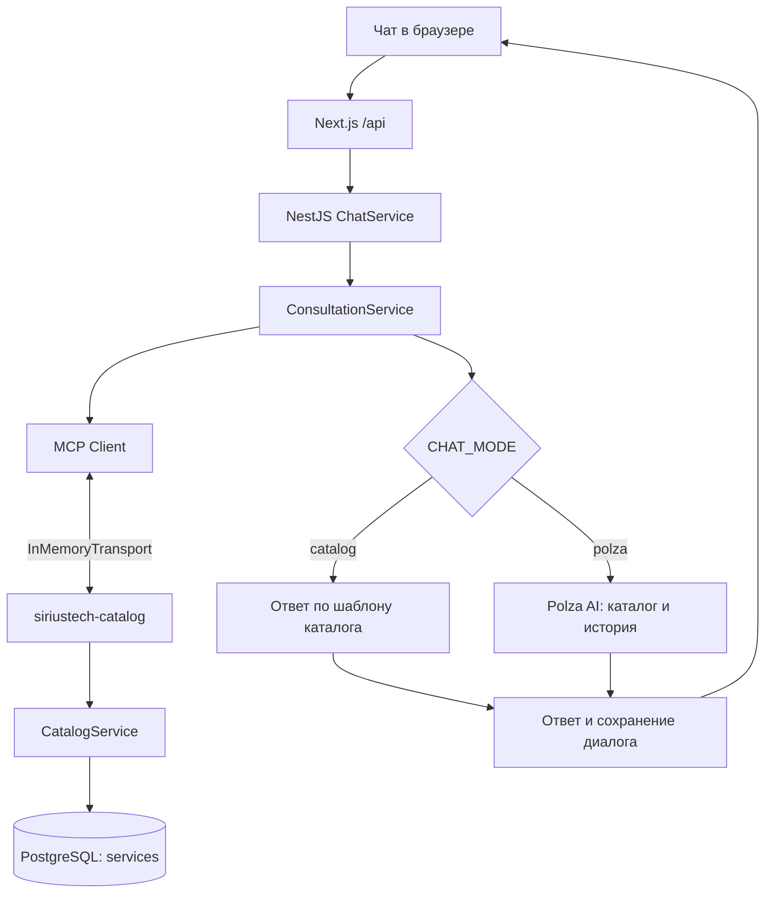

# MCP в СириусТех: что и как внедрено

Документ описывает реализацию в репозитории на 26 октября 2026 года. Здесь собраны оба применения MCP: работа с материалами дизайна и доступ консультанта к каталогу услуг.

## 1. Что такое MCP и зачем он нам

MCP — Model Context Protocol, протокол взаимодействия клиента с сервером, предоставляющим инструменты, ресурсы и шаблоны запросов. В нашем проекте сервер описывает, какие данные можно получить и какие аргументы нужно передать; клиент вызывает эти возможности через SDK.

| Применение | Что подключали | Результат в проекте |
| --- | --- | --- |
| Подготовка интерфейса | Figma через `figma-mcp-bridge` | Исходные изображения макета, SVG-логотип, основа UI kit |
| Работа приложения | Собственный сервер `siriustech-catalog` | Доступ к услугам, FAQ, стоимости, срокам и подбору услуг |

MCP не является языковой моделью или базой данных. PostgreSQL хранит каталог, MCP предоставляет к нему интерфейс, а Polza AI формирует текст ответа по переданным сведениям. Сайт может работать в справочном режиме без Polza, продолжая получать данные через MCP.

## 2. Как MCP использовался для дизайна

В [описании исходных материалов](reference/README.md) зафиксирован экспорт из файла **SiriusTech26**, страницы **Page 1**, через `figma-mcp-bridge` от 7 октября 2026 года.

| Материал | Узел Figma | Файл в репозитории | Использование |
| --- | --- | --- | --- |
| UI kit, 1600×4440 | `237:4772` | [ui-kit.png](reference/ui-kit.png) | Сверка компонентов и состояний |
| Услуги, 1344×1800 | `241:17416` | [services.png](reference/services.png) | Основа оформления каталога |
| Векторный логотип | `237:4937` | [siriustech.svg](../public/brand/siriustech.svg) | Логотип в интерфейсе и основа favicon |

Материалы перенесли в React-компоненты, CSS Modules и общие токены. В [Brand](../src/shared/ui/brand.tsx) сохранены векторные контуры логотипа, цвет надписи адаптирован через `currentColor`. Дальнейшие изменения выполнены в исходном коде: локальные шрифты, композиции интерфейсов, адаптивность, глобус, сокращение текста.

Figma MCP нужен на этапе разработки. Для открытия сайта не требуется подключение браузера к Figma. Экспорт изображения также не означает автоматическую генерацию готового React-приложения.

В репозитории нет полного журнала вызовов Figma MCP, поэтому здесь указаны подтверждённые материалы и узлы, без выдуманного списка команд. В [раннем дизайн-брифе](design-system-blue.md) есть задание для Stitch; само наличие брифа не подтверждает использование Stitch MCP или автоматический перенос его результата в приложение.

## 3. Собственный MCP-сервер каталога

Сервер создан функцией `createCatalogMcp(catalog)` в [catalog-server.ts](../backend/src/mcp/catalog-server.ts). Его имя — `siriustech-catalog`, версия в протоколе — `1.0.0`.

| Средство | Что делает |
| --- | --- |
| `@modelcontextprotocol/sdk` | Создаёт MCP-сервер, клиент и транспорты; в package.json указан диапазон `^1.28.0` |
| Zod | Проверяет аргументы инструментов и структуру данных услуг |
| NestJS | Предоставляет каталог и консультацию через внедрение зависимостей, обслуживает HTTP endpoint |
| PostgreSQL и `pg` | Хранят услуги и читают их параметризованными SQL-запросами |
| `InMemoryTransport` | Соединяет MCP-клиент чата с сервером внутри процесса |
| `StdioServerTransport` | Подключает внешнего клиента через отдельный локальный процесс |
| `StreamableHTTPServerTransport` | Подключает внешнего клиента через HTTP |

Одна фабрика сервера используется во всех трёх транспортах. Поэтому набор инструментов не нужно реализовывать заново для сайта, локального клиента и HTTP-клиента.

## 4. Что сервер предоставляет клиенту

### Инструменты — tools

| Имя | Аргументы | Результат |
| --- | --- | --- |
| `list_services` | `{ query?: string }`, до 2000 символов | Все услуги либо совпадения с поисковым запросом |
| `get_service` | `{ serviceId: string }`, 1–100 символов | Одна услуга: описание, состав работ, стоимость, сроки, FAQ, уточняющие вопросы |
| `recommend_services` | `{ task: string }`, 1–2000 символов | До трёх услуг по описанию задачи |

Результат инструмента передаётся как текстовый блок MCP, внутри которого сериализован JSON. При ошибке получения одной услуги `get_service` возвращает `isError: true`.

Все инструменты помечены `readOnlyHint: true`, `destructiveHint: false`, `idempotentHint: true`, `openWorldHint: false`. Это метаданные о поведении. Фактическое ограничение обеспечивается реализацией: инструменты вызывают только методы чтения каталога. Для заявок, диалогов и изменения данных MCP-инструментов нет.

### Ресурс — resource

`siriustech://services` — адрес ресурса с полным каталогом в формате `application/json`. Это URI внутри MCP, а не обычная ссылка сайта. Клиент читает его методом чтения ресурсов MCP.

### Шаблон запроса — prompt

`service_consultation({ task })` возвращает сообщение с заданием подобрать услугу, использовать `recommend_services` и `get_service`, уточнить требования и обозначить демонстрационный характер цен. Шаблон сам не запускает инструменты и не отправляет заявку.

## 5. Как реализован подбор

[CatalogService](../backend/src/catalog/catalog.service.ts) читает таблицу `services`. Начальные 12 услуг находятся в [services.json](../backend/data/services.json) и попадают в PostgreSQL через seed. В каждой услуге есть `keywords`, `deliverables`, `questions`, `faq`, цена и сроки.

`rankServices` приводит запрос к нижнему регистру, выделяет слова и сравнивает их с названием, описанием и ключевыми словами услуги. Балл — количество совпавших слов. Совпадения сортируются по баллу; `recommend_services` берёт первые три.

Это простой поиск по словам, без векторной базы, embeddings и отдельной модели рекомендаций. Если подходящих слов нет, результат может быть пустым. Если после фильтрации слов запрос пуст, функция возвращает исходный список.

## 6. Как MCP связан с чатом сайта



Последовательность в [ConsultationService](../backend/src/chat/consultation.service.ts):

1. Создаются MCP-сервер, клиент `siriustech-chat` и связанная пара `InMemoryTransport`.
2. Клиент подключается к серверу через SDK.
3. Если пользователь выбрал услугу, вызывается `get_service({ serviceId })`. Если тема не выбрана, вызывается `list_services({})`.
4. JSON из результата разбирается и проверяется через `serviceSchema`. Клиент и сервер закрываются в `finally`.
5. В режиме `catalog` формируется справочный ответ; без выбранной услуги применяется `rankServices`.
6. В режиме `polza` проверенные данные каталога, последние 12 сообщений истории и новый вопрос передаются в API Polza. Ответ проверяется перед возвратом.

Выбор MCP-инструмента в текущем чате делает код backend. Модель Polza не подключается к `/mcp` и не выбирает инструменты самостоятельно через function calling. `recommend_services`, resource и prompt доступны внешним MCP-клиентам, но текущий сайт напрямую их не вызывает.

Например, после выбора карточки «Сайты и корпоративные порталы» интерфейс передаёт `serviceId: "web"`. Консультация получает сведения через `get_service`, а Polza использует их как контекст. Краткие описания карточек на лендинге не заменяют подробный каталог для консультанта.

Внешний запрос идёт на `https://polza.ai/api/v1/chat/completions`. Модель задаётся через `POLZA_MODEL`; в примере используется `openai/gpt-4o-mini`. Тайм-аут — 45 секунд. При ошибке провайдера backend возвращает 503, интерфейс предлагает повторить запрос; скрытого переключения на справочный ответ нет.

## 7. Настройка и подключение

Установите зависимости и создайте env-файлы по [README](../README.md). Значения ниже — назначение параметров, не реальные ключи.

| Переменная в backend/.env | Назначение |
| --- | --- |
| `DATABASE_URL` | Подключение к PostgreSQL |
| `CHAT_MODE` | `catalog` или `polza` |
| `POLZA_API_KEY` | Ключ провайдера, обязателен для режима `polza` |
| `POLZA_MODEL` | Идентификатор модели |
| `POLZA_PROXY_URL` | Необязательный HTTP/HTTPS-прокси только для запросов к Polza |
| `MCP_API_TOKEN` | Bearer-токен для внешнего HTTP MCP |
| `HOST`, `PORT` | Адрес NestJS, по умолчанию `127.0.0.1:4000` |
| `FRONTEND_ORIGIN` | Разрешённый Origin, по умолчанию `http://localhost:3000` |

Обычный сайт запускается через `bun run dev`. Для его внутреннего MCP-соединения `MCP_API_TOKEN` не нужен: этот токен относится к внешнему HTTP endpoint.

### Локальный клиент: stdio

Подготовьте базу и соберите backend:

```sh
bun run backend:build
```

Пример конфигурации клиента, поддерживающего формат `mcpServers`:

```json
{
  "mcpServers": {
    "siriustech": {
      "command": "node",
      "args": ["C:/absolute/path/to/siriustech/backend/dist/mcp/stdio.js"]
    }
  }
}
```

Замените путь на свой. Клиент запускает отдельный процесс Node.js. Он читает `backend/.env` независимо от рабочей папки клиента и обращается к базе напрямую; отдельный NestJS HTTP-сервер для stdio не требуется. PostgreSQL должен быть запущен и подготовлен.

В конфигурации запуска используется непосредственно `node`, чтобы stdout содержал только сообщения MCP. Служебные сообщения пакетного менеджера могут нарушить протокол. Настройки подключения конкретного клиента могут отличаться от примера.

### Внешний клиент: Streamable HTTP

Запустите NestJS и задайте непустой `MCP_API_TOKEN`. Параметры подключения:

```text
Транспорт: Streamable HTTP
URL: http://127.0.0.1:4000/mcp
Authorization: Bearer <значение MCP_API_TOKEN>
```

После инициализации MCP-клиент может вызвать, например, `tools/list` или `tools/call` с `name: "get_service"` и `arguments: { "serviceId": "web" }`.

Endpoint работает без серверной MCP-сессии: `sessionIdGenerator: undefined`, ответы JSON. При пустом токене он возвращает 503, при неправильном — 401. Проверяется Origin, если заголовок присутствует. После проверок доступа методы, отличные от POST, получают 405. Адрес `/mcp` не проксируется через Next.js `/api`.

## 8. Где находится код

| Файл | Ответственность |
| --- | --- |
| [mcp/catalog-server.ts](../backend/src/mcp/catalog-server.ts) | Регистрация tools, resource и prompt |
| [mcp/stdio.ts](../backend/src/mcp/stdio.ts) | Локальный транспорт и завершение процесса |
| [mcp/mcp.controller.ts](../backend/src/mcp/mcp.controller.ts) | HTTP-транспорт, токен, Origin и методы |
| [catalog/catalog.service.ts](../backend/src/catalog/catalog.service.ts) | Чтение данных, Zod-схема, ранжирование |
| [chat/consultation.service.ts](../backend/src/chat/consultation.service.ts) | MCP-клиент, справочный ответ, Polza |
| [chat/chat.service.ts](../backend/src/chat/chat.service.ts) | Сессии, история, сохранение, идемпотентность сообщений |
| [config.ts](../backend/src/config.ts) | Загрузка и проверка настроек |
| [backend.test.cjs](../backend/tests/backend.test.cjs) | Интеграционные проверки API, базы и MCP |

## 9. Проверка и ограничения

```sh
bun run test:backend
```

Тесты поднимают изолированный PostgreSQL, проверяют API, реальное подключение MCP через SDK, доступ к каталогу и обработку ошибок. Polza подменяется в тестах: проверка не делает платных запросов. Подробности хранения истории и лимитов — в [backend.md](backend.md).

MCP выдаёт демонстрационные данные каталога. Он не предоставляет доступ к заявкам, контактам пользователей или переписке. Политика ответов задаётся системными сообщениями, но сама по себе не гарантирует безошибочность модели. HTTP-токен не превращает локальный сервер в полностью подготовленный публичный сервис: внешнее развёртывание требует отдельной настройки HTTPS и доступа.

## 10. Короткое объяснение на защите

«MCP использован в двух местах. Через Figma MCP получили исходные материалы интерфейса. Для самого приложения создали свой MCP-сервер с инструментами чтения каталога. Чат вызывает его через SDK внутри backend, проверяет результат и передаёт данные модели Polza. Модель пишет ответ, а каталог остаётся источником сведений об услугах. Эти же инструменты можно подключить к внешнему клиенту через stdio или HTTP».
